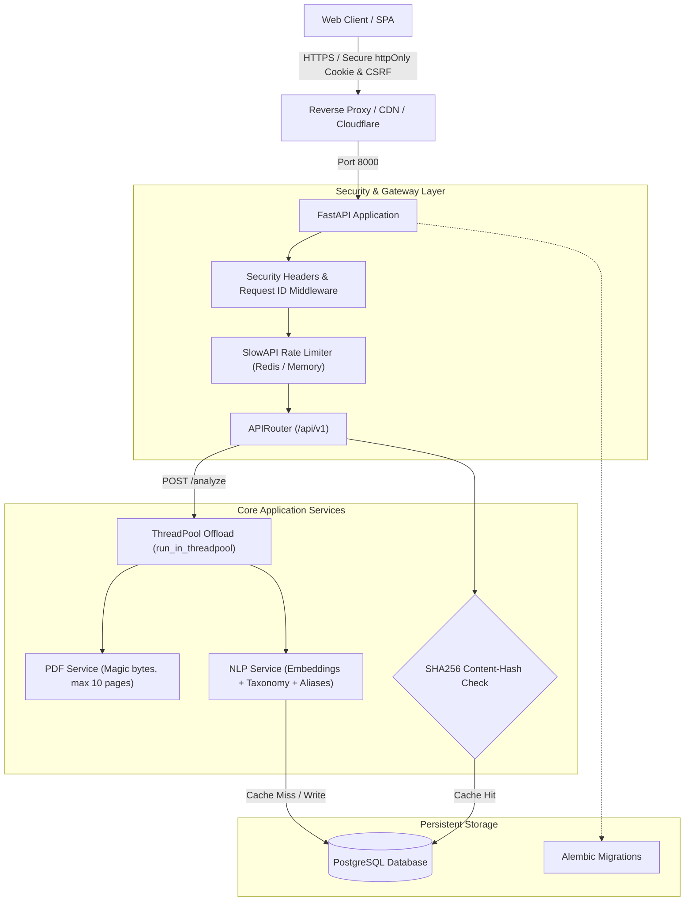

# ResumeFit: Production-Grade Resume & Job Match Engine

[](https://www.python.org/downloads/)
[](https://fastapi.tiangolo.com)
[](https://www.postgresql.org/)
[](LICENSE)
[](tests/)

ResumeFit transforms resumes from generic self-descriptions into quantified, ATS-optimized assets targeted directly at specific job postings. It blends transformer embeddings, skill coverage taxonomies with alias mapping, defensive parsing, and rule/LLM rewrite engines.

---

## Architecture & Data Flow



---

## Key Features

1. **Enterprise Packaging & Architecture**: Clean separation into `core/`, `models/`, `schemas/`, `services/`, and `routers/api_v1/`.
2. **Defensive PDF Extraction**: Hard caps on file size (5MB), page limits (max 10 pages), magic byte checks (`%PDF`), and scanned PDF detection.
3. **Non-Blocking Threadpool Offload**: All CPU-intensive embedding and parsing workloads run via `run_in_threadpool`, keeping the async event loop responsive.
4. **Deterministic Content-Hash Caching**: SHA256 hashing of (resume + job description) prevents redundant inference and database costs.
5. **Hardened Security & Auth**:
   - `httpOnly`, `Secure`, `SameSite=lax` session cookies.
   - Dual-layer CSRF protection for state-changing endpoints.
   - Rotatable signing keys with `kid` JWT header support.
   - Minimum 10-character password enforcement with bcrypt hashing.
   - Strict Content Security Policy (CSP), HSTS, frame-ancestors, and X-Content-Type-Options headers.
6. **Skill Taxonomy & Aliases**: Normalized mapping of 25+ real-world aliases (e.g. `k8s` → `kubernetes`, `postgres` → `postgresql`, `js` → `javascript`).
7. **Production Observability & Probes**: Standard liveness (`/healthz`) and readiness (`/readyz`) health checks inspecting database and ML engine status.
8. **Container Ready**: Multi-stage, non-root `Dockerfile` and automated `docker-compose.yml` with PostgreSQL 16 and Redis 7.

---

## Quickstart

### Option 1: Local Development (Python)

```bash
# 1. Clone repository
git clone https://github.com/your-username/resumefit.git
cd resumefit

# 2. Create virtual environment
python -m venv .venv
# On Windows:
.venv\Scripts\activate
# On Linux/macOS:
source .venv/bin/activate

# 3. Install dependencies
pip install -r requirements-dev.txt

# 4. Configure environment
cp .env.example .env

# 5. Run database migrations
alembic upgrade head

# 6. Start the server
uvicorn app.main:app --reload --port 8000
```
Open **http://127.0.0.1:8000** in your browser.

---

### Option 2: Docker Compose (PostgreSQL + Redis)

```bash
docker-compose up --build
```
This spins up:
- ResumeFit web application on port `8000`
- PostgreSQL 16 on port `5432`
- Redis 7 on port `6379`

---

## Environment Variables

| Variable | Default | Purpose |
| :--- | :--- | :--- |
| `APP_ENV` | `dev` | Environment mode: `dev`, `test`, `staging`, or `prod` |
| `SECRET_KEY` | *(generated)* | Primary JWT signing key (minimum 32 chars in prod) |
| `PREVIOUS_SECRET_KEY`| *None* | Secondary key for zero-downtime key rotation |
| `DATABASE_URL` | `sqlite:///./app.db` | PostgreSQL connection string for production |
| `REDIS_URL` | *None* | Redis connection string for distributed rate limits & queues |
| `COOKIE_SECURE` | `false` | Set to `true` behind HTTPS |
| `MAX_PDF_PAGES` | `10` | Hard cap on uploaded PDF pages |
| `MAX_PDF_BYTES` | `5242880` | Hard cap on file upload size (5MB) |
| `EMBED_MODEL` | `all-MiniLM-L6-v2` | Sentence-transformer model identifier |
| `ANTHROPIC_API_KEY` | *None* | Optional Anthropic API key for AI rewrites |

---

## Running the Automated Test Suite

```bash
python -m pytest -v
```

Test coverage includes:
- **`tests/test_nlp.py`**: Semantic similarity scoring, canonical skills, skill alias resolution, bullet detection, and rule rewrites.
- **`tests/test_authorization.py`**: Tenant isolation verification (User B cannot read, list, or delete User A's data).
- **`tests/test_auth.py`**: Password policy checks, CSRF issuance, registration, and login.
- **`tests/test_analyze.py`**: Input character thresholds, PDF page limits, and content-hash caching.
- **`tests/test_health.py`**: `/healthz` liveness and `/readyz` readiness endpoints.

---

## Architecture Decision Records (ADRs)

1. **Embeddings vs TF-IDF**: Uses Sentence Transformers (`all-MiniLM-L6-v2`) for semantic nuance with automatic TF-IDF fallback for minimal-dependency environments.
2. **Cookies vs LocalStorage**: Implemented `httpOnly` secure cookies with double-submit / header CSRF tokens to safeguard against XSS token harvesting.
3. **Event Loop Non-Blocking**: Heavy CPU workloads (PDF text extraction and neural embeddings) are offloaded to `run_in_threadpool` worker threads to preserve FastAPI event loop latency.

---

## License

Distributed under the MIT License. See [LICENSE](LICENSE) for more information.
